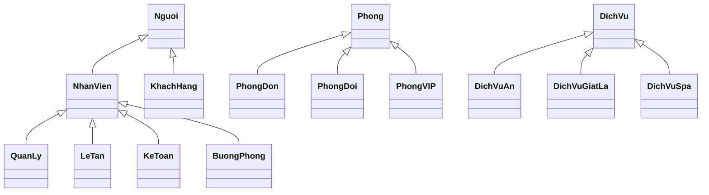

# 📚 BÁO CÁO ĐỒ ÁN OOP – HỆ THỐNG QUẢN LÝ KHÁCH SẠN (Hotel Management)

> [!NOTE]
> Tài liệu này bao gồm: (1) Phân chia công việc cho 4 thành viên, (2) Lý thuyết OOP để trả lời câu hỏi, (3) Chi tiết từng yêu cầu đồ án đã thỏa mãn trong code – ở đâu, như thế nào.

---

## 📋 MỤC LỤC

1. [PHẦN 1: PHÂN CHIA CÔNG VIỆC CHO 4 THÀNH VIÊN](#phần-1-phân-chia-công-việc-cho-4-thành-viên)
2. [PHẦN 2: LÝ THUYẾT OOP](#phần-2-lý-thuyết-oop)
3. [PHẦN 3: CHI TIẾT YÊU CẦU ĐỒ ÁN ĐÃ THỎA MÃN TRONG CODE](#phần-3-chi-tiết-yêu-cầu-đồ-án-đã-thỏa-mãn-trong-code)
4. [PHẦN 4: SƠ ĐỒ LỚP (CLASS DIAGRAM)](#phần-4-sơ-đồ-lớp-class-diagram)

---

# PHẦN 1: PHÂN CHIA CÔNG VIỆC CHO 4 THÀNH VIÊN

## 🔥 Tổng quan dự án

Hệ thống Quản Lý Khách Sạn gồm **25 class/interface** chia thành các module:
- **Nhân sự** (Người, Nhân viên, các loại nhân viên, Khách hàng)
- **Phòng** (Phong, PhongDon, PhongDoi, PhongVIP)
- **Dịch vụ** (DichVu, DichVuAn, DichVuGiatLa, DichVuSpa)
- **Nghiệp vụ** (DatPhong, HoaDon, TaiKhoan)
- **Danh sách** (7 lớp DanhSach + IFileIO)
- **Giao diện chính** (Main, Utils)
- **Interface** (IFileIO, IThanhToan, IXacThuc)

## 📊 Bảng phân chia công việc

| Thành viên | Vai trò | Các class phụ trách | Mô tả chi tiết |
|:-:|:-:|:-:|:-:|
| **SV1** | Trưởng nhóm – Module Nhân sự & Kế thừa | `Nguoi` (abstract), `NhanVien` (abstract), `QuanLy`, `LeTan`, `KeToan`, `BuongPhong`, `KhachHang` | Thiết kế hệ thống phân cấp kế thừa Nguoi → NhanVien → (QuanLy, LeTan, KeToan, BuongPhong). Xây dựng lớp trừu tượng Nguoi, NhanVien. Implement đa hình qua các phương thức `tinhLuong()`, `hienThiThongTin()`, `getVaiTro()`. Thuộc tính static `demSoKhach` trong KhachHang. |
| **SV2** | Module Phòng & Dịch vụ | `Phong` (abstract), `PhongDon`, `PhongDoi`, `PhongVIP`, `DichVu`, `DichVuAn`, `DichVuGiatLa`, `DichVuSpa` | Thiết kế hệ thống phân cấp kế thừa Phong → (PhongDon, PhongDoi, PhongVIP) và DichVu → (DichVuAn, DichVuGiatLa, DichVuSpa). Implement đa hình qua `tinhGia(int soDem)`. Thuộc tính static `tongSoPhong` trong Phong. |
| **SV3** | Module Danh sách (Mảng) & File I/O | `DanhSachPhong`, `DanhSachNhanVien`, `DanhSachKhachHang`, `DanhSachDichVu`, `DanhSachDatPhong`, `DanhSachHoaDon`, `DanhSachTaiKhoan`, `IFileIO` | Xây dựng 7 lớp quản lý mảng đối tượng (dùng mảng thường `[]` và `ArrayList`). Implement interface IFileIO. Viết code đọc/ghi file text cho tất cả các danh sách. Tự mở rộng mảng khi đầy (dynamic array). |
| **SV4** | Module Nghiệp vụ & Giao diện chính | `DatPhong`, `HoaDon`, `TaiKhoan`, `IThanhToan`, `IXacThuc`, `Main`, `Utils` | Thiết kế luồng nghiệp vụ: đặt phòng, lập hóa đơn, thanh toán, đăng nhập/đăng xuất. HoaDon implements IThanhToan. TaiKhoan implements IXacThuc. Xây dựng menu chính theo vai trò. Static method `maHoaMatKhau()`, `dangXuat()` trong TaiKhoan. Utilities class với static methods. |

## 📌 Chi tiết từng thành viên phải hiểu & có thể gõ lại

### 👤 SV1 – Module Nhân sự (7 class)

**Phải nắm vững:**
- Cách khai báo lớp trừu tượng (`abstract class Nguoi`, `abstract class NhanVien`)
- Hàm trừu tượng: `hienThiThongTin()`, `getVaiTro()` trong Nguoi; `tinhLuong()` trong NhanVien
- Kế thừa đa tầng: Nguoi → NhanVien → QuanLy/LeTan/KeToan/BuongPhong
- Kế thừa trực tiếp: Nguoi → KhachHang
- Constructor gọi `super()`
- Override (`@Override`) các phương thức trừu tượng
- Thuộc tính static: `demSoKhach` trong KhachHang
- Đa hình qua `tinhLuong()`: mỗi loại nhân viên tính lương khác nhau

**Có thể bị hỏi gõ lại:**
- Khai báo lớp Nguoi với abstract methods
- Khai báo lớp QuanLy kế thừa NhanVien với `tinhLuong()` override
- Giải thích tại sao `Nguoi` và `NhanVien` là abstract

### 👤 SV2 – Module Phòng & Dịch vụ (8 class)

**Phải nắm vững:**
- Lớp abstract Phong với `tinhGia(int soDem)` trừu tượng
- 3 lớp con PhongDon, PhongDoi, PhongVIP kế thừa Phong
- Mỗi loại phòng tính giá khác nhau → **đa hình**
- Lớp DichVu (không abstract) với 3 lớp con kế thừa
- Thuộc tính static `tongSoPhong` trong Phong
- Constructor chain: `super()` gọi constructor cha

**Có thể bị hỏi gõ lại:**
- Khai báo lớp Phong abstract, PhongVIP kế thừa và override `tinhGia()`
- Giải thích tại sao PhongDon, PhongDoi, PhongVIP tính giá khác nhau

### 👤 SV3 – Module Danh sách & File I/O (8 class/interface)

**Phải nắm vững:**
- Interface IFileIO: `docFile(String path)`, `ghiFile(String path)`
- 4 lớp dùng mảng thường `[]`: DanhSachPhong, DanhSachNhanVien, DanhSachDatPhong (+ tự mở rộng mảng)
- 4 lớp dùng ArrayList: DanhSachKhachHang, DanhSachDichVu, DanhSachHoaDon, DanhSachTaiKhoan
- Các thao tác CRUD: thêm, xóa, tìm, sửa, hiển thị
- Đọc/ghi file text: BufferedReader, PrintWriter, split("|")
- Tạo đối tượng từ chuỗi file (factory pattern đơn giản)
- `instanceof` để phân biệt loại đối tượng khi ghi file

**Có thể bị hỏi gõ lại:**
- Viết hàm `them()` với tự mở rộng mảng
- Viết hàm `docFile()` đọc file text và tạo đối tượng
- Giải thích interface IFileIO

### 👤 SV4 – Module Nghiệp vụ & Main (7 class/interface)

**Phải nắm vững:**
- Interface IThanhToan: `tinhTien()`, `thanhToan()`
- Interface IXacThuc: `dangNhap()`
- HoaDon implements IThanhToan
- TaiKhoan implements IXacThuc
- Static field `taiKhoanHienTai` và static methods trong TaiKhoan
- Mã hóa mật khẩu Caesar đơn giản (static method)
- Luồng nghiệp vụ: đăng nhập → hiển thị menu theo vai trò → thao tác
- Class Utils: tất cả static methods (nhapSo, nhapChuoi, dinhDangTien)
- Main: kết nối tất cả module lại

**Có thể bị hỏi gõ lại:**
- Viết interface IThanhToan và class HoaDon implement nó
- Viết hàm đăng nhập trong TaiKhoan
- Giải thích static trong Utils

---

# PHẦN 2: LÝ THUYẾT OOP

## 2.1. Lập trình hướng đối tượng (OOP) là gì?

**Định nghĩa:** Lập trình hướng đối tượng (Object-Oriented Programming – OOP) là phương pháp lập trình dựa trên khái niệm **đối tượng (object)**. Đối tượng chứa **dữ liệu** (thuộc tính/fields) và **hành vi** (phương thức/methods).

**4 tính chất cơ bản của OOP:**
1. **Tính đóng gói (Encapsulation)**
2. **Tính kế thừa (Inheritance)**
3. **Tính đa hình (Polymorphism)**
4. **Tính trừu tượng (Abstraction)**

---

## 2.2. Lớp (Class) và Đối tượng (Object)

### Class là gì?
- **Class** là một **khuôn mẫu (blueprint/template)** dùng để tạo ra các đối tượng.
- Class định nghĩa: thuộc tính (fields/attributes) và phương thức (methods/behaviors).

**Cú pháp:**
```java
public class TenLop {
    // Thuộc tính (fields)
    private String ten;
    private int tuoi;

    // Hàm thiết lập (Constructor)
    public TenLop(String ten, int tuoi) {
        this.ten = ten;
        this.tuoi = tuoi;
    }

    // Phương thức (Method)
    public void hienThi() {
        System.out.println(ten + " - " + tuoi);
    }
}
```

### Object là gì?
- **Object** (đối tượng) là một **thể hiện cụ thể (instance)** của một class.
- Tạo đối tượng bằng từ khóa `new`.

```java
TenLop obj = new TenLop("An", 20);
obj.hienThi(); // An - 20
```

### Sự khác nhau giữa Class và Object:
| Class | Object |
|-------|--------|
| Là khuôn mẫu, không chiếm bộ nhớ lúc runtime | Là thể hiện cụ thể, chiếm bộ nhớ trên Heap |
| Được khai báo bằng từ khóa `class` | Được tạo bằng từ khóa `new` |
| Chỉ khai báo 1 lần | Có thể tạo nhiều đối tượng từ 1 class |

---

## 2.3. Hàm thiết lập (Constructor)

### Định nghĩa
- **Constructor** là phương thức đặc biệt được gọi **tự động** khi tạo đối tượng bằng `new`.
- **Tên constructor = tên class**, **không có kiểu trả về** (kể cả void).

### Các loại Constructor:

**1. Constructor mặc định (default/no-arg constructor):**
```java
public Nguoi() {
    ma = "";
    hoTen = "";
    namSinh = 0;
}
```

**2. Constructor có tham số (parameterized constructor):**
```java
public Nguoi(String ma, String hoTen, int namSinh,
             String gioiTinh, String soDienThoai, String diaChi) {
    this.ma = ma;
    this.hoTen = hoTen;
    this.namSinh = namSinh;
    // ...
}
```

**3. Gọi constructor cha bằng `super()`:**
```java
public NhanVien(String ma, String hoTen, int namSinh, ...) {
    super(ma, hoTen, namSinh, ...); // gọi constructor của Nguoi
    this.luongCoBan = luongCoBan;
}
```

### Từ khóa `this`:
- `this` trỏ đến đối tượng hiện tại.
- Dùng để phân biệt thuộc tính của đối tượng với tham số có cùng tên.

```java
this.ma = ma; // this.ma là thuộc tính, ma là tham số
```

---

## 2.4. Tính đóng gói (Encapsulation)

### Định nghĩa
- **Đóng gói** là ẩn giấu thông tin bên trong đối tượng, chỉ cho phép truy cập qua **getter/setter**.
- Thuộc tính khai báo `private`, phương thức truy cập khai báo `public`.

### Access Modifiers (Phạm vi truy cập):

| Modifier | Cùng class | Cùng package | Lớp con | Bất kỳ đâu |
|----------|:----------:|:------------:|:-------:|:----------:|
| `private` | ✅ | ❌ | ❌ | ❌ |
| `default` (không viết gì) | ✅ | ✅ | ❌ | ❌ |
| `protected` | ✅ | ✅ | ✅ | ❌ |
| `public` | ✅ | ✅ | ✅ | ✅ |

### Ví dụ Getter/Setter:
```java
private String hoTen; // thuộc tính private

public String getHoTen() {    // getter
    return hoTen;
}

public void setHoTen(String hoTen) {  // setter
    this.hoTen = hoTen;
}
```

### Tại sao cần đóng gói?
- **Bảo vệ dữ liệu**: không cho truy cập trực tiếp, tránh sửa đổi sai.
- **Kiểm soát**: có thể validate dữ liệu trong setter trước khi gán.
- **Linh hoạt**: thay đổi cách lưu trữ bên trong mà không ảnh hưởng code bên ngoài.

---

## 2.5. Tính kế thừa (Inheritance)

### Định nghĩa
- **Kế thừa** cho phép một lớp con (subclass/child class) **thừa hưởng** thuộc tính và phương thức từ lớp cha (superclass/parent class).
- Sử dụng từ khóa `extends`.

### Cú pháp:
```java
public class NhanVien extends Nguoi {
    // NhanVien kế thừa tất cả thuộc tính/phương thức public/protected của Nguoi
}
```

### Các loại kế thừa trong Java:
- **Kế thừa đơn (Single)**: `A extends B` – Java hỗ trợ
- **Kế thừa đa tầng (Multi-level)**: `C extends B`, `B extends A` – Java hỗ trợ
- **Kế thừa bội (Multiple)**: `C extends A, B` – Java **KHÔNG** hỗ trợ (dùng interface thay thế)

### Từ khóa `super`:
- `super()` – gọi constructor của lớp cha
- `super.tenPhuongThuc()` – gọi phương thức của lớp cha

### Tại sao cần kế thừa?
- **Tái sử dụng code (Code Reuse)**: không phải viết lại.
- **Mở rộng**: thêm thuộc tính/phương thức mới ở lớp con.
- **Quan hệ IS-A**: "NhanVien IS-A Nguoi", "PhongDon IS-A Phong".

---

## 2.6. Tính đa hình (Polymorphism)

### Định nghĩa
- **Đa hình** (poly = nhiều, morph = hình dạng) là khả năng một phương thức có **nhiều cách thực thi khác nhau** tùy thuộc vào đối tượng thực tế gọi nó.

### 2 loại đa hình:

**1. Đa hình tại thời điểm biên dịch (Compile-time / Static Polymorphism):**
- Thực hiện qua **Method Overloading** (nạp chồng phương thức)
- Cùng tên, khác tham số

```java
// Overloading ví dụ
public int tinhTong(int a, int b) { return a + b; }
public double tinhTong(double a, double b) { return a + b; }
```

**2. Đa hình tại thời điểm chạy (Runtime / Dynamic Polymorphism):**
- Thực hiện qua **Method Overriding** (ghi đè phương thức)
- Lớp con viết lại phương thức của lớp cha

```java
// Trong lớp cha Nguoi:
public abstract void hienThiThongTin();

// Override ở KhachHang:
@Override
public void hienThiThongTin() {
    System.out.println("Ma khach: " + getMa());
    // ...
}

// Override ở NhanVien:
@Override
public void hienThiThongTin() {
    System.out.println("Ma nhan vien: " + getMa());
    // ...
}
```

### Ý nghĩa đa hình:
```java
Nguoi nguoi1 = new KhachHang(...);
Nguoi nguoi2 = new QuanLy(...);
nguoi1.hienThiThongTin(); // Gọi hienThiThongTin() của KhachHang
nguoi2.hienThiThongTin(); // Gọi hienThiThongTin() của QuanLy
// Cùng kiểu Nguoi, nhưng hành vi khác nhau → ĐA HÌNH
```

---

## 2.7. Tính trừu tượng (Abstraction)

### Định nghĩa
- **Trừu tượng** là ẩn đi chi tiết cài đặt, chỉ hiển thị **giao diện (interface)** / **chức năng** cho người dùng.
- Thực hiện qua: **abstract class** và **interface**.

### Abstract Class (Lớp trừu tượng):

```java
public abstract class Nguoi {
    // Có thể có thuộc tính
    private String ma;

    // Có thể có method thường (có body)
    public String getMa() { return ma; }

    // CÓ abstract method (không có body)
    public abstract void hienThiThongTin();
    public abstract String getVaiTro();
}
```

**Đặc điểm:**
- Khai báo bằng từ khóa `abstract`
- **Không thể tạo đối tượng** trực tiếp: `new Nguoi()` → LỖI
- Có thể chứa cả phương thức thường và phương thức trừu tượng
- Có thể có constructor (dùng bởi lớp con qua `super()`)
- Lớp con **PHẢI** override tất cả abstract methods hoặc cũng phải là abstract

### Tại sao dùng Abstract?
- Bắt buộc lớp con phải cài đặt các phương thức quan trọng
- Định nghĩa "hợp đồng" (contract) mà lớp con phải tuân theo
- Ví dụ: mọi Nguoi phải có `hienThiThongTin()` nhưng mỗi loại hiển thị khác nhau

---

## 2.8. Interface (Giao diện)

### Định nghĩa
- **Interface** là một "hợp đồng" định nghĩa các phương thức mà lớp **phải** cài đặt.
- Chỉ chứa **khai báo phương thức** (abstract methods), không có body (trước Java 8).

### Cú pháp:
```java
public interface IThanhToan {
    double tinhTien();
    void thanhToan();
}

// Lớp implement interface:
public class HoaDon implements IThanhToan {
    @Override
    public double tinhTien() {
        // Cài đặt cụ thể
        return tienPhong + tienDichVu - giamGia;
    }

    @Override
    public void thanhToan() {
        tongTien = tinhTien();
        trangThai = "Da thanh toan";
    }
}
```

### So sánh Abstract Class vs Interface:

| Tiêu chí | Abstract Class | Interface |
|----------|:-------------:|:---------:|
| Từ khóa | `abstract class` | `interface` |
| Kế thừa | `extends` (1 lớp cha duy nhất) | `implements` (nhiều interface) |
| Thuộc tính | Có thể có instance variables | Chỉ có `public static final` (constants) |
| Constructor | Có | Không |
| Method body | Có thể có | Không (trước Java 8) |
| Mục đích | Chia sẻ code chung + bắt buộc cài đặt | Định nghĩa "hợp đồng" thuần túy |
| Đa kế thừa | Không (1 class chỉ extends 1 class) | Có (1 class implements nhiều interfaces) |

### Tại sao dùng Interface?
- **Đa kế thừa**: Java không cho phép kế thừa nhiều class, nhưng cho phép implement nhiều interface.
- **Loose coupling**: giảm phụ thuộc giữa các module.
- **Ví dụ**: `HoaDon implements IThanhToan` – HoaDon biết tính tiền; `TaiKhoan implements IXacThuc` – TaiKhoan biết xác thực.

---

## 2.9. Từ khóa `static`

### Thuộc tính Static:
- Thuộc tính `static` thuộc về **class**, không thuộc về bất kỳ object nào.
- Tất cả object chia sẻ chung 1 biến static.

```java
public class Phong {
    public static int tongSoPhong = 0;  // Biến đếm chung

    public Phong() {
        tongSoPhong++;  // Mỗi khi tạo Phong, tăng bộ đếm
    }
}
// Truy cập: Phong.tongSoPhong (không cần tạo đối tượng)
```

### Phương thức Static:
- Gọi được **không cần tạo đối tượng**.
- **Không** truy cập được thuộc tính non-static.

```java
public class Utils {
    public static int nhapSo(String thongBao) {
        // ...
    }
}
// Gọi: Utils.nhapSo("Nhap so: ");
```

### Khi nào dùng static?
- **Biến đếm** chung (counter): `tongSoPhong`, `demSoKhach`
- **Utility methods** (phương thức tiện ích): `Utils.nhapSo()`, `Utils.dinhDangTien()`
- **Biến lưu trạng thái toàn cục**: `TaiKhoan.taiKhoanHienTai`

---

## 2.10. Mảng đối tượng (Array of Objects)

### Mảng tĩnh:
```java
private Phong[] ds = new Phong[10]; // Mảng 10 phần tử
```

### Tự mở rộng mảng (Dynamic Array):
```java
if (soLuong == ds.length) {
    Phong[] mangMoi = new Phong[ds.length * 2]; // Tạo mảng gấp đôi
    System.arraycopy(ds, 0, mangMoi, 0, soLuong); // Copy
    ds = mangMoi; // Trỏ về mảng mới
}
```

### ArrayList:
```java
private ArrayList<KhachHang> ds = new ArrayList<KhachHang>();
ds.add(khach);        // thêm
ds.remove(khach);     // xóa
ds.get(i);            // lấy phần tử
ds.size();            // kích thước
```

### So sánh Mảng [] vs ArrayList:
| Mảng [] | ArrayList |
|---------|-----------|
| Kích thước cố định | Tự mở rộng |
| Truy cập bằng `ds[i]` | Truy cập bằng `ds.get(i)` |
| Phải tự xử lý mở rộng | Java quản lý tự động |
| Kiểu nguyên thủy + đối tượng | Chỉ đối tượng (wrapper cho kiểu nguyên thủy) |

---

## 2.11. Đọc/Ghi File Text

### Đọc file:
```java
BufferedReader br = new BufferedReader(new FileReader("data/phong.txt"));
String dong;
while ((dong = br.readLine()) != null) {
    String[] parts = dong.split("\\|"); // Tách bằng ký tự |
    // Xử lý dữ liệu...
}
br.close();
```

### Ghi file:
```java
PrintWriter pw = new PrintWriter(new FileWriter("data/phong.txt"));
pw.println("DON|P101|Phong don 101|1|Trong|300000|0");
pw.close();
```

### Định dạng file text trong đồ án:
- Mỗi dòng là 1 đối tượng
- Các trường cách nhau bằng ký tự `|`
- Ví dụ: `LETAN|NV01|Nguyen Le Tan|1998|Nam|0900000001|Ha Noi|7000000|01/01/2022|500000`

---

## 2.12. Từ khóa `instanceof`

- Dùng để kiểm tra một đối tượng có phải là thể hiện của một lớp không.

```java
if (p instanceof PhongDon) {
    // p là PhongDon
    PhongDon phongDon = (PhongDon) p; // Ép kiểu
    double phuThu = phongDon.getPhuThu();
}
```

---

## 2.13. Các câu hỏi lý thuyết thường gặp

### ❓ "OOP là gì? Kể 4 tính chất?"
**Trả lời:** OOP là phương pháp lập trình dựa trên đối tượng (object). 4 tính chất: Đóng gói, Kế thừa, Đa hình, Trừu tượng.

### ❓ "Kế thừa là gì? Lợi ích?"
**Trả lời:** Kế thừa cho phép lớp con thừa hưởng thuộc tính/phương thức của lớp cha, dùng từ khóa `extends`. Lợi ích: tái sử dụng code, mở rộng chức năng, thể hiện quan hệ IS-A.

### ❓ "Đa hình là gì? Cho ví dụ?"
**Trả lời:** Đa hình là khả năng cùng một phương thức có nhiều cách thực hiện khác nhau. Ví dụ: `tinhLuong()` trong QuanLy tính khác LeTan. Biến kiểu `NhanVien` trỏ đến đối tượng QuanLy/LeTan sẽ gọi phương thức tương ứng.

### ❓ "Abstract class khác gì Interface?"
**Trả lời:** Abstract class có thể có constructor, thuộc tính, method có body; một class chỉ extends 1 abstract class. Interface chỉ khai báo method, không có constructor; một class có thể implements nhiều interface.

### ❓ "Static là gì? Khi nào dùng?"
**Trả lời:** Static thuộc về class, không thuộc object. Dùng khi cần biến dùng chung (counter, trạng thái toàn cục) hoặc phương thức tiện ích không cần tạo đối tượng.

### ❓ "Constructor là gì? Đặc điểm?"
**Trả lời:** Constructor là phương thức đặc biệt được gọi tự động khi tạo đối tượng bằng `new`. Tên trùng tên class, không có kiểu trả về. Có thể overload (nhiều constructor khác tham số).

### ❓ "Encapsulation là gì?"
**Trả lời:** Đóng gói là ẩn giấu dữ liệu bên trong class bằng `private`, chỉ cho truy cập qua `public` getter/setter. Mục đích: bảo vệ dữ liệu, kiểm soát truy cập.

---

# PHẦN 3: CHI TIẾT YÊU CẦU ĐỒ ÁN ĐÃ THỎA MÃN TRONG CODE

## ✅ Yêu cầu 1: Có ít nhất 16 class (nhóm 4 sinh viên) — 1 điểm

### Danh sách đầy đủ 25 class/interface trong dự án:

| STT | Tên class/interface | File | Loại | Package |
|:---:|:---:|:---:|:---:|:---:|
| 1 | `Nguoi` | [Nguoi.java](file:///d:/test/oop/QLKS/HotelManagement/src/model/Nguoi.java) | abstract class | model |
| 2 | `NhanVien` | [NhanVien.java](file:///d:/test/oop/QLKS/HotelManagement/src/model/NhanVien.java) | abstract class | model |
| 3 | `QuanLy` | [QuanLy.java](file:///d:/test/oop/QLKS/HotelManagement/src/model/QuanLy.java) | class | model |
| 4 | `LeTan` | [LeTan.java](file:///d:/test/oop/QLKS/HotelManagement/src/model/LeTan.java) | class | model |
| 5 | `KeToan` | [KeToan.java](file:///d:/test/oop/QLKS/HotelManagement/src/model/KeToan.java) | class | model |
| 6 | `BuongPhong` | [BuongPhong.java](file:///d:/test/oop/QLKS/HotelManagement/src/model/BuongPhong.java) | class | model |
| 7 | `KhachHang` | [KhachHang.java](file:///d:/test/oop/QLKS/HotelManagement/src/model/KhachHang.java) | class | model |
| 8 | `Phong` | [Phong.java](file:///d:/test/oop/QLKS/HotelManagement/src/model/Phong.java) | abstract class | model |
| 9 | `PhongDon` | [PhongDon.java](file:///d:/test/oop/QLKS/HotelManagement/src/model/PhongDon.java) | class | model |
| 10 | `PhongDoi` | [PhongDoi.java](file:///d:/test/oop/QLKS/HotelManagement/src/model/PhongDoi.java) | class | model |
| 11 | `PhongVIP` | [PhongVIP.java](file:///d:/test/oop/QLKS/HotelManagement/src/model/PhongVIP.java) | class | model |
| 12 | `DichVu` | [DichVu.java](file:///d:/test/oop/QLKS/HotelManagement/src/model/DichVu.java) | class | model |
| 13 | `DichVuAn` | [DichVuAn.java](file:///d:/test/oop/QLKS/HotelManagement/src/model/DichVuAn.java) | class | model |
| 14 | `DichVuGiatLa` | [DichVuGiatLa.java](file:///d:/test/oop/QLKS/HotelManagement/src/model/DichVuGiatLa.java) | class | model |
| 15 | `DichVuSpa` | [DichVuSpa.java](file:///d:/test/oop/QLKS/HotelManagement/src/model/DichVuSpa.java) | class | model |
| 16 | `DatPhong` | [DatPhong.java](file:///d:/test/oop/QLKS/HotelManagement/src/model/DatPhong.java) | class | model |
| 17 | `HoaDon` | [HoaDon.java](file:///d:/test/oop/QLKS/HotelManagement/src/model/HoaDon.java) | class | model |
| 18 | `TaiKhoan` | [TaiKhoan.java](file:///d:/test/oop/QLKS/HotelManagement/src/model/TaiKhoan.java) | class | model |
| 19 | `DanhSachPhong` | [DanhSachPhong.java](file:///d:/test/oop/QLKS/HotelManagement/src/model/DanhSachPhong.java) | class | model |
| 20 | `DanhSachNhanVien` | [DanhSachNhanVien.java](file:///d:/test/oop/QLKS/HotelManagement/src/model/DanhSachNhanVien.java) | class | model |
| 21 | `DanhSachKhachHang` | [DanhSachKhachHang.java](file:///d:/test/oop/QLKS/HotelManagement/src/model/DanhSachKhachHang.java) | class | model |
| 22 | `DanhSachDichVu` | [DanhSachDichVu.java](file:///d:/test/oop/QLKS/HotelManagement/src/model/DanhSachDichVu.java) | class | model |
| 23 | `DanhSachDatPhong` | [DanhSachDatPhong.java](file:///d:/test/oop/QLKS/HotelManagement/src/model/DanhSachDatPhong.java) | class | model |
| 24 | `DanhSachHoaDon` | [DanhSachHoaDon.java](file:///d:/test/oop/QLKS/HotelManagement/src/model/DanhSachHoaDon.java) | class | model |
| 25 | `DanhSachTaiKhoan` | [DanhSachTaiKhoan.java](file:///d:/test/oop/QLKS/HotelManagement/src/model/DanhSachTaiKhoan.java) | class | model |
| 26 | `IFileIO` | [IFileIO.java](file:///d:/test/oop/QLKS/HotelManagement/src/interfaces/IFileIO.java) | interface | interfaces |
| 27 | `IThanhToan` | [IThanhToan.java](file:///d:/test/oop/QLKS/HotelManagement/src/interfaces/IThanhToan.java) | interface | interfaces |
| 28 | `IXacThuc` | [IXacThuc.java](file:///d:/test/oop/QLKS/HotelManagement/src/interfaces/IXacThuc.java) | interface | interfaces |
| 29 | `Main` | [Main.java](file:///d:/test/oop/QLKS/HotelManagement/src/app/Main.java) | class | app |
| 30 | `Utils` | [Utils.java](file:///d:/test/oop/QLKS/HotelManagement/src/app/Utils.java) | class | app |

> **Tổng: 30 class/interface. Yêu cầu tối thiểu 16 class → ĐẠT (gấp gần 2 lần yêu cầu)**

---

## ✅ Yêu cầu 2: Các lớp phải có hàm thiết lập (Constructor) — 1 điểm

### Chi tiết: TẤT CẢ các class đều có constructor

| Class | Constructor mặc định (no-arg) | Constructor có tham số | File & Dòng |
|:---:|:---:|:---:|:---:|
| `Nguoi` | ✅ `Nguoi()` – dòng 11 | ✅ `Nguoi(String, String, int, String, String, String)` – dòng 20 | [Nguoi.java#L11-L28](file:///d:/test/oop/QLKS/HotelManagement/src/model/Nguoi.java#L11-L28) |
| `NhanVien` | ✅ `NhanVien()` – dòng 7, gọi `super()` | ✅ `NhanVien(...)` – dòng 13, gọi `super(...)` | [NhanVien.java#L7-L19](file:///d:/test/oop/QLKS/HotelManagement/src/model/NhanVien.java#L7-L19) |
| `QuanLy` | ✅ `QuanLy()` – dòng 6, gọi `super()` | ✅ `QuanLy(...)` – dòng 11, gọi `super(...)` | [QuanLy.java#L6-L18](file:///d:/test/oop/QLKS/HotelManagement/src/model/QuanLy.java#L6-L18) |
| `LeTan` | ✅ `LeTan()` – dòng 6 | ✅ `LeTan(...)` – dòng 11 | [LeTan.java#L6-L17](file:///d:/test/oop/QLKS/HotelManagement/src/model/LeTan.java#L6-L17) |
| `KeToan` | ✅ `KeToan()` – dòng 6 | ✅ `KeToan(...)` – dòng 11 | [KeToan.java#L6-L17](file:///d:/test/oop/QLKS/HotelManagement/src/model/KeToan.java#L6-L17) |
| `BuongPhong` | ✅ `BuongPhong()` – dòng 6 | ✅ `BuongPhong(...)` – dòng 11 | [BuongPhong.java#L6-L18](file:///d:/test/oop/QLKS/HotelManagement/src/model/BuongPhong.java#L6-L18) |
| `KhachHang` | ✅ `KhachHang()` – dòng 9 | ✅ `KhachHang(...)` – dòng 16 | [KhachHang.java#L9-L23](file:///d:/test/oop/QLKS/HotelManagement/src/model/KhachHang.java#L9-L23) |
| `Phong` | ✅ `Phong()` – dòng 12 | ✅ `Phong(...)` – dòng 21 | [Phong.java#L12-L29](file:///d:/test/oop/QLKS/HotelManagement/src/model/Phong.java#L12-L29) |
| `PhongDon` | ✅ `PhongDon()` – dòng 6 | ✅ `PhongDon(...)` – dòng 11 | [PhongDon.java#L6-L15](file:///d:/test/oop/QLKS/HotelManagement/src/model/PhongDon.java#L6-L15) |
| `PhongDoi` | ✅ `PhongDoi()` – dòng 6 | ✅ `PhongDoi(...)` – dòng 11 | [PhongDoi.java#L6-L15](file:///d:/test/oop/QLKS/HotelManagement/src/model/PhongDoi.java#L6-L15) |
| `PhongVIP` | ✅ `PhongVIP()` – dòng 6 | ✅ `PhongVIP(...)` – dòng 11 | [PhongVIP.java#L6-L15](file:///d:/test/oop/QLKS/HotelManagement/src/model/PhongVIP.java#L6-L15) |
| `DichVu` | ✅ `DichVu()` – dòng 9 | ✅ `DichVu(...)` – dòng 16 | [DichVu.java#L9-L22](file:///d:/test/oop/QLKS/HotelManagement/src/model/DichVu.java#L9-L22) |
| `DichVuAn` | ✅ `DichVuAn()` – dòng 6 | ✅ `DichVuAn(...)` – dòng 11 | [DichVuAn.java#L6-L14](file:///d:/test/oop/QLKS/HotelManagement/src/model/DichVuAn.java#L6-L14) |
| `DichVuGiatLa` | ✅ dòng 6 | ✅ dòng 11 | [DichVuGiatLa.java#L6-L14](file:///d:/test/oop/QLKS/HotelManagement/src/model/DichVuGiatLa.java#L6-L14) |
| `DichVuSpa` | ✅ dòng 6 | ✅ dòng 11 | [DichVuSpa.java#L6-L14](file:///d:/test/oop/QLKS/HotelManagement/src/model/DichVuSpa.java#L6-L14) |
| `DatPhong` | ✅ dòng 12 | ✅ dòng 22 | [DatPhong.java#L12-L32](file:///d:/test/oop/QLKS/HotelManagement/src/model/DatPhong.java#L12-L32) |
| `HoaDon` | ✅ dòng 16 | ✅ dòng 28 | [HoaDon.java#L16-L40](file:///d:/test/oop/QLKS/HotelManagement/src/model/HoaDon.java#L16-L40) |
| `TaiKhoan` | ✅ dòng 14 | ✅ dòng 22 | [TaiKhoan.java#L14-L30](file:///d:/test/oop/QLKS/HotelManagement/src/model/TaiKhoan.java#L14-L30) |
| Các DanhSach | ✅ Tất cả đều có constructor khởi tạo mảng/ArrayList | — | Mỗi file DanhSach*.java |

> **Tất cả class đều có ít nhất 1 constructor, hầu hết có 2 (mặc định + có tham số) → ĐẠT**

---

## ✅ Yêu cầu 3: Có kế thừa hợp lý — 1 điểm

### Sơ đồ kế thừa:



### Chi tiết từng quan hệ kế thừa:

| Lớp cha | Lớp con | Loại kế thừa | File & Dòng khai báo | Giải thích hợp lý |
|:---:|:---:|:---:|:---:|:---:|
| `Nguoi` | `NhanVien` | Multi-level | [NhanVien.java#L3](file:///d:/test/oop/QLKS/HotelManagement/src/model/NhanVien.java#L3) | NhanVien IS-A Nguoi (nhân viên là người) |
| `Nguoi` | `KhachHang` | Single | [KhachHang.java#L3](file:///d:/test/oop/QLKS/HotelManagement/src/model/KhachHang.java#L3) | KhachHang IS-A Nguoi (khách hàng là người) |
| `NhanVien` | `QuanLy` | Multi-level | [QuanLy.java#L3](file:///d:/test/oop/QLKS/HotelManagement/src/model/QuanLy.java#L3) | QuanLy IS-A NhanVien (quản lý là nhân viên) |
| `NhanVien` | `LeTan` | Multi-level | [LeTan.java#L3](file:///d:/test/oop/QLKS/HotelManagement/src/model/LeTan.java#L3) | LeTan IS-A NhanVien |
| `NhanVien` | `KeToan` | Multi-level | [KeToan.java#L3](file:///d:/test/oop/QLKS/HotelManagement/src/model/KeToan.java#L3) | KeToan IS-A NhanVien |
| `NhanVien` | `BuongPhong` | Multi-level | [BuongPhong.java#L3](file:///d:/test/oop/QLKS/HotelManagement/src/model/BuongPhong.java#L3) | BuongPhong IS-A NhanVien |
| `Phong` | `PhongDon` | Single | [PhongDon.java#L3](file:///d:/test/oop/QLKS/HotelManagement/src/model/PhongDon.java#L3) | PhongDon IS-A Phong |
| `Phong` | `PhongDoi` | Single | [PhongDoi.java#L3](file:///d:/test/oop/QLKS/HotelManagement/src/model/PhongDoi.java#L3) | PhongDoi IS-A Phong |
| `Phong` | `PhongVIP` | Single | [PhongVIP.java#L3](file:///d:/test/oop/QLKS/HotelManagement/src/model/PhongVIP.java#L3) | PhongVIP IS-A Phong |
| `DichVu` | `DichVuAn` | Single | [DichVuAn.java#L3](file:///d:/test/oop/QLKS/HotelManagement/src/model/DichVuAn.java#L3) | DichVuAn IS-A DichVu |
| `DichVu` | `DichVuGiatLa` | Single | [DichVuGiatLa.java#L3](file:///d:/test/oop/QLKS/HotelManagement/src/model/DichVuGiatLa.java#L3) | DichVuGiatLa IS-A DichVu |
| `DichVu` | `DichVuSpa` | Single | [DichVuSpa.java#L3](file:///d:/test/oop/QLKS/HotelManagement/src/model/DichVuSpa.java#L3) | DichVuSpa IS-A DichVu |

> **Có 3 cây kế thừa: Nguoi (6 lớp), Phong (4 lớp), DichVu (4 lớp). Cả kế thừa đơn và đa tầng. Quan hệ IS-A hợp lý với nghiệp vụ khách sạn → ĐẠT**

---

## ✅ Yêu cầu 4: Cài đặt và sử dụng đa hình — 1 điểm

### 4.1. Đa hình qua `tinhLuong()` – 4 cách tính lương khác nhau

| Lớp | Phương thức override | Cách tính | File & Dòng |
|:---:|:---:|:---:|:---:|
| `QuanLy` | `tinhLuong()` | `luongCoBan * heSoChucVu` | [QuanLy.java#L20-L23](file:///d:/test/oop/QLKS/HotelManagement/src/model/QuanLy.java#L20-L23) |
| `LeTan` | `tinhLuong()` | `luongCoBan + phuCap` | [LeTan.java#L19-L22](file:///d:/test/oop/QLKS/HotelManagement/src/model/LeTan.java#L19-L22) |
| `KeToan` | `tinhLuong()` | `luongCoBan + thuong` | [KeToan.java#L20-L22](file:///d:/test/oop/QLKS/HotelManagement/src/model/KeToan.java#L20-L22) |
| `BuongPhong` | `tinhLuong()` | `luongCoBan + soPhongPhuTrach * 100000` | [BuongPhong.java#L20-L23](file:///d:/test/oop/QLKS/HotelManagement/src/model/BuongPhong.java#L20-L23) |

**Sử dụng đa hình tại** [Main.java#L467-L473](file:///d:/test/oop/QLKS/HotelManagement/src/app/Main.java#L467-L473):
```java
for (int i = 0; i < dsNhanVien.getSoLuong(); i++) {
    NhanVien nhanVien = dsNhanVien.get(i);  // Biến kiểu NhanVien
    nhanVien.tinhLuong();  // Gọi tinhLuong() → Đa hình: gọi đúng method của lớp con
}
```

### 4.2. Đa hình qua `tinhGia(int soDem)` – 3 cách tính giá phòng khác nhau

| Lớp | Cách tính | File & Dòng |
|:---:|:---:|:---:|
| `PhongDon` | `(giaCoBan + phuThu) * soDem` | [PhongDon.java#L17-L20](file:///d:/test/oop/QLKS/HotelManagement/src/model/PhongDon.java#L17-L20) |
| `PhongDoi` | `giaCoBan * soDem + soGiuong * 50000` | [PhongDoi.java#L17-L20](file:///d:/test/oop/QLKS/HotelManagement/src/model/PhongDoi.java#L17-L20) |
| `PhongVIP` | `(giaCoBan + phiDichVu) * soDem * 1.2` | [PhongVIP.java#L17-L20](file:///d:/test/oop/QLKS/HotelManagement/src/model/PhongVIP.java#L17-L20) |

**Sử dụng đa hình tại** [Main.java#L392](file:///d:/test/oop/QLKS/HotelManagement/src/app/Main.java#L392):
```java
Phong phong = dsPhong.tim(datPhong.getMaPhong()); // Kiểu Phong (cha)
double tienPhong = phong.tinhGia(datPhong.getSoDem()); // Đa hình!
```

### 4.3. Đa hình qua `hienThiThongTin()` và `getVaiTro()`

- `hienThiThongTin()` override ở KhachHang, NhanVien → mỗi loại hiển thị khác nhau
- `getVaiTro()` override ở QuanLy ("QUANLY"), LeTan ("LETAN"), KeToan ("KETOAN"), BuongPhong ("BUONGPHONG"), KhachHang ("KHACH")

**Sử dụng đa hình tại** [DanhSachPhong.java#L63-L68](file:///d:/test/oop/QLKS/HotelManagement/src/model/DanhSachPhong.java#L63-L68):
```java
for (int i = 0; i < soLuong; i++) {
    ds[i].hienThiThongTin(); // ds[i] có thể là PhongDon, PhongDoi, PhongVIP → Đa hình
}
```

> **Có nhiều hệ thống đa hình: tinhLuong, tinhGia, hienThiThongTin, getVaiTro. Sử dụng đa hình thực sự (biến kiểu cha gọi method, chạy đúng method lớp con) → ĐẠT**

---

## ✅ Yêu cầu 5: Lớp mảng các đối tượng (Array) — 2 điểm

### 7 lớp quản lý mảng đối tượng:

| Lớp | Kiểu lưu trữ | Phần tử | Các thao tác | File |
|:---:|:---:|:---:|:---:|:---:|
| `DanhSachPhong` | `Phong[]` (mảng thường) | Phong | them, xoa, tim, sua, hienThi, docFile, ghiFile | [DanhSachPhong.java](file:///d:/test/oop/QLKS/HotelManagement/src/model/DanhSachPhong.java) |
| `DanhSachNhanVien` | `NhanVien[]` (mảng thường) | NhanVien | them, xoa, tim, sua, hienThi, docFile, ghiFile | [DanhSachNhanVien.java](file:///d:/test/oop/QLKS/HotelManagement/src/model/DanhSachNhanVien.java) |
| `DanhSachDatPhong` | `DatPhong[]` (mảng thường) | DatPhong | them, xoa, tim, sua, hienThi, docFile, ghiFile | [DanhSachDatPhong.java](file:///d:/test/oop/QLKS/HotelManagement/src/model/DanhSachDatPhong.java) |
| `DanhSachKhachHang` | `ArrayList<KhachHang>` | KhachHang | them, xoa, tim, sua, hienThi, docFile, ghiFile | [DanhSachKhachHang.java](file:///d:/test/oop/QLKS/HotelManagement/src/model/DanhSachKhachHang.java) |
| `DanhSachDichVu` | `ArrayList<DichVu>` | DichVu | them, xoa, tim, sua, hienThi, docFile, ghiFile | [DanhSachDichVu.java](file:///d:/test/oop/QLKS/HotelManagement/src/model/DanhSachDichVu.java) |
| `DanhSachHoaDon` | `ArrayList<HoaDon>` | HoaDon | them, xoa, tim, sua, hienThi, tinhDoanhThu, docFile, ghiFile | [DanhSachHoaDon.java](file:///d:/test/oop/QLKS/HotelManagement/src/model/DanhSachHoaDon.java) |
| `DanhSachTaiKhoan` | `ArrayList<TaiKhoan>` | TaiKhoan | them, xoa, tim, sua, hienThi, dangNhap, docFile, ghiFile | [DanhSachTaiKhoan.java](file:///d:/test/oop/QLKS/HotelManagement/src/model/DanhSachTaiKhoan.java) |

### Tự mở rộng mảng (Dynamic Array) – điểm nổi bật:

Tại [DanhSachPhong.java#L22-L27](file:///d:/test/oop/QLKS/HotelManagement/src/model/DanhSachPhong.java#L22-L27):
```java
if (soLuong == ds.length) {
    Phong[] mangMoi = new Phong[ds.length * 2]; // Nhân đôi kích thước
    System.arraycopy(ds, 0, mangMoi, 0, soLuong); // Copy sang mảng mới
    ds = mangMoi;
}
```

Tương tự tại DanhSachNhanVien (dòng 22-27) và DanhSachDatPhong (dòng 22-27).

> **Có 7 lớp mảng đối tượng, sử dụng cả mảng thường [] (3 lớp) và ArrayList (4 lớp). Có CRUD đầy đủ. Có tự mở rộng mảng → ĐẠT (2đ)**

---

## ✅ Yêu cầu 6: Đọc và ghi dữ liệu lên file (text) — 1 điểm

### 7 file data:

| File | Dữ liệu | Lớp đọc/ghi | Đọc tại | Ghi tại |
|:---:|:---:|:---:|:---:|:---:|
| `data/phong.txt` | Phòng | DanhSachPhong | [DanhSachPhong.java#L91-L109](file:///d:/test/oop/QLKS/HotelManagement/src/model/DanhSachPhong.java#L91-L109) | [DanhSachPhong.java#L135-L158](file:///d:/test/oop/QLKS/HotelManagement/src/model/DanhSachPhong.java#L135-L158) |
| `data/nhanvien.txt` | Nhân viên | DanhSachNhanVien | [DanhSachNhanVien.java#L91-L106](file:///d:/test/oop/QLKS/HotelManagement/src/model/DanhSachNhanVien.java#L91-L106) | [DanhSachNhanVien.java#L142-L167](file:///d:/test/oop/QLKS/HotelManagement/src/model/DanhSachNhanVien.java#L142-L167) |
| `data/khachhang.txt` | Khách hàng | DanhSachKhachHang | [DanhSachKhachHang.java#L80-L98](file:///d:/test/oop/QLKS/HotelManagement/src/model/DanhSachKhachHang.java#L80-L98) | [DanhSachKhachHang.java#L102-L116](file:///d:/test/oop/QLKS/HotelManagement/src/model/DanhSachKhachHang.java#L102-L116) |
| `data/taikhoan.txt` | Tài khoản | DanhSachTaiKhoan | [DanhSachTaiKhoan.java#L88-L108](file:///d:/test/oop/QLKS/HotelManagement/src/model/DanhSachTaiKhoan.java#L88-L108) | [DanhSachTaiKhoan.java#L111-L124](file:///d:/test/oop/QLKS/HotelManagement/src/model/DanhSachTaiKhoan.java#L111-L124) |
| `data/datphong.txt` | Đặt phòng | DanhSachDatPhong | [DanhSachDatPhong.java#L91-L109](file:///d:/test/oop/QLKS/HotelManagement/src/model/DanhSachDatPhong.java#L91-L109) | [DanhSachDatPhong.java#L113-L127](file:///d:/test/oop/QLKS/HotelManagement/src/model/DanhSachDatPhong.java#L113-L127) |
| `data/hoadon.txt` | Hóa đơn | DanhSachHoaDon | [DanhSachHoaDon.java#L90-L109](file:///d:/test/oop/QLKS/HotelManagement/src/model/DanhSachHoaDon.java#L90-L109) | [DanhSachHoaDon.java#L113-L128](file:///d:/test/oop/QLKS/HotelManagement/src/model/DanhSachHoaDon.java#L113-L128) |
| `data/dichvu.txt` | Dịch vụ | DanhSachDichVu | [DanhSachDichVu.java#L80-L94](file:///d:/test/oop/QLKS/HotelManagement/src/model/DanhSachDichVu.java#L80-L94) | [DanhSachDichVu.java#L118-L142](file:///d:/test/oop/QLKS/HotelManagement/src/model/DanhSachDichVu.java#L118-L142) |

### Cách hoạt động:
- **Đọc file**: `BufferedReader` + `FileReader` → đọc từng dòng → `split("\\|")` → tạo đối tượng → `them()` vào danh sách
- **Ghi file**: `PrintWriter` + `FileWriter` → duyệt danh sách → ghi từng dòng với ký tự `|` ngăn cách
- **Gọi đọc khi bắt đầu chương trình**: [Main.java#L75-L83](file:///d:/test/oop/QLKS/HotelManagement/src/app/Main.java#L75-L83) `docDuLieu()`
- **Gọi ghi khi thoát/thay đổi**: [Main.java#L91-L99](file:///d:/test/oop/QLKS/HotelManagement/src/app/Main.java#L91-L99) `ghiDuLieu()`

### Đa hình khi đọc file (nhận dạng loại đối tượng):
```java
// DanhSachPhong.docFile() → taoPhong()
if (loai.equals("DON")) return new PhongDon(...);
if (loai.equals("DOI")) return new PhongDoi(...);
return new PhongVIP(...);
```

> **7 file text, đọc/ghi đầy đủ bằng BufferedReader/PrintWriter. Xử lý exception. Dữ liệu persist qua các lần chạy → ĐẠT**

---

## ✅ Yêu cầu 7: Có thuộc tính static, phương thức static — 1 điểm

### Thuộc tính static:

| Class | Thuộc tính static | Mục đích | File & Dòng |
|:---:|:---:|:---:|:---:|
| `KhachHang` | `public static int demSoKhach = 0` | Đếm tổng số khách hàng đã tạo | [KhachHang.java#L7](file:///d:/test/oop/QLKS/HotelManagement/src/model/KhachHang.java#L7) |
| `Phong` | `public static int tongSoPhong = 0` | Đếm tổng số phòng đã tạo | [Phong.java#L10](file:///d:/test/oop/QLKS/HotelManagement/src/model/Phong.java#L10) |
| `TaiKhoan` | `public static TaiKhoan taiKhoanHienTai` | Lưu tài khoản đang đăng nhập (Singleton-like) | [TaiKhoan.java#L12](file:///d:/test/oop/QLKS/HotelManagement/src/model/TaiKhoan.java#L12) |
| `Utils` | `public static Scanner scanner` | Scanner dùng chung cho toàn bộ chương trình | [Utils.java#L7](file:///d:/test/oop/QLKS/HotelManagement/src/app/Utils.java#L7) |

### Phương thức static:

| Class | Phương thức static | Mục đích | File & Dòng |
|:---:|:---:|:---:|:---:|
| `TaiKhoan` | `static String maHoaMatKhau(String)` | Mã hóa Caesar mật khẩu (dịch ký tự +3) | [TaiKhoan.java#L46-L52](file:///d:/test/oop/QLKS/HotelManagement/src/model/TaiKhoan.java#L46-L52) |
| `TaiKhoan` | `static void dangXuat()` | Đặt `taiKhoanHienTai = null` | [TaiKhoan.java#L54-L56](file:///d:/test/oop/QLKS/HotelManagement/src/model/TaiKhoan.java#L54-L56) |
| `Utils` | `static int nhapSo(String)` | Nhập số nguyên từ bàn phím | [Utils.java#L9-L18](file:///d:/test/oop/QLKS/HotelManagement/src/app/Utils.java#L9-L18) |
| `Utils` | `static double nhapSoThuc(String)` | Nhập số thực từ bàn phím | [Utils.java#L20-L29](file:///d:/test/oop/QLKS/HotelManagement/src/app/Utils.java#L20-L29) |
| `Utils` | `static String nhapChuoi(String)` | Nhập chuỗi từ bàn phím | [Utils.java#L31-L34](file:///d:/test/oop/QLKS/HotelManagement/src/app/Utils.java#L31-L34) |
| `Utils` | `static String dinhDangTien(double)` | Format tiền VND có dấu phân cách | [Utils.java#L36-L39](file:///d:/test/oop/QLKS/HotelManagement/src/app/Utils.java#L36-L39) |
| `Utils` | `static boolean laSoDuong(int)` | Kiểm tra số dương | [Utils.java#L41-L43](file:///d:/test/oop/QLKS/HotelManagement/src/app/Utils.java#L41-L43) |
| `Main` | `static main(String[])` | Điểm bắt đầu chương trình | [Main.java#L43-L46](file:///d:/test/oop/QLKS/HotelManagement/src/app/Main.java#L43-L46) |

> **4 thuộc tính static (đếm, trạng thái toàn cục, scanner chung) + 8 phương thức static (tiện ích, mã hóa, đăng xuất) → ĐẠT**

---

## ✅ Yêu cầu 8: Có lớp trừu tượng, hàm trừu tượng (Abstract) — 1 điểm

### 3 lớp trừu tượng:

| Abstract Class | Abstract Methods | Lớp con bắt buộc override | File |
|:---:|:---:|:---:|:---:|
| `Nguoi` | `abstract void hienThiThongTin()` (dòng 30) | NhanVien, KhachHang | [Nguoi.java#L3](file:///d:/test/oop/QLKS/HotelManagement/src/model/Nguoi.java#L3) |
| | `abstract String getVaiTro()` (dòng 32) | QuanLy, LeTan, KeToan, BuongPhong, KhachHang | |
| `NhanVien` | `abstract double tinhLuong()` (dòng 21) | QuanLy, LeTan, KeToan, BuongPhong | [NhanVien.java#L3](file:///d:/test/oop/QLKS/HotelManagement/src/model/NhanVien.java#L3) |
| `Phong` | `abstract double tinhGia(int soDem)` (dòng 31) | PhongDon, PhongDoi, PhongVIP | [Phong.java#L3](file:///d:/test/oop/QLKS/HotelManagement/src/model/Phong.java#L3) |

### Cách khai báo chi tiết:

**Nguoi.java:**
```java
public abstract class Nguoi {                          // Dòng 3
    public abstract void hienThiThongTin();             // Dòng 30
    public abstract String getVaiTro();                 // Dòng 32
}
```

**NhanVien.java:**
```java
public abstract class NhanVien extends Nguoi {          // Dòng 3
    public abstract double tinhLuong();                  // Dòng 21
    // hienThiThongTin() đã override tại dòng 23-34 (không còn abstract)
}
```

**Phong.java:**
```java
public abstract class Phong {                           // Dòng 3
    public abstract double tinhGia(int soDem);          // Dòng 31
}
```

> **3 abstract class + 4 abstract methods. Kế thừa đa tầng abstract (Nguoi → NhanVien → QuanLy). Tất cả abstract methods đều được override ở lớp con → ĐẠT**

---

## ✅ Yêu cầu 9: Có Interface — 1 điểm

### 3 Interface:

| Interface | Methods | Lớp implement | File |
|:---:|:---:|:---:|:---:|
| `IFileIO` | `void docFile(String path)`, `void ghiFile(String path)` | DanhSachPhong, DanhSachNhanVien, DanhSachKhachHang, DanhSachDichVu, DanhSachDatPhong, DanhSachHoaDon, DanhSachTaiKhoan (**7 lớp**) | [IFileIO.java](file:///d:/test/oop/QLKS/HotelManagement/src/interfaces/IFileIO.java) |
| `IThanhToan` | `double tinhTien()`, `void thanhToan()` | `HoaDon` | [IThanhToan.java](file:///d:/test/oop/QLKS/HotelManagement/src/interfaces/IThanhToan.java) |
| `IXacThuc` | `boolean dangNhap(String user, String pass)` | `TaiKhoan` | [IXacThuc.java](file:///d:/test/oop/QLKS/HotelManagement/src/interfaces/IXacThuc.java) |

### Cách sử dụng Interface (đa hình qua interface):

**Tại Main.java dòng 85-88:**
```java
private void docNeuCo(interfaces.IFileIO danhSach, String path) {
    if (new File(path).exists()) {
        danhSach.docFile(path); // Đa hình qua interface IFileIO!
    }
}
```
→ Tham số kiểu `IFileIO`, truyền vào `DanhSachPhong`, `DanhSachNhanVien`, v.v. – đây là **đa hình qua interface**.

**HoaDon implements IThanhToan** ([HoaDon.java#L5](file:///d:/test/oop/QLKS/HotelManagement/src/model/HoaDon.java#L5)):
```java
public class HoaDon implements IThanhToan {
    @Override
    public double tinhTien() { ... }    // dòng 42-49
    @Override
    public void thanhToan() { ... }     // dòng 51-55
}
```

**TaiKhoan implements IXacThuc** ([TaiKhoan.java#L5](file:///d:/test/oop/QLKS/HotelManagement/src/model/TaiKhoan.java#L5)):
```java
public class TaiKhoan implements IXacThuc {
    @Override
    public boolean dangNhap(String user, String pass) { ... }  // dòng 32-43
}
```

> **3 interface với 9 lớp implement. IFileIO có 7 lớp implement → đa hình qua interface rõ ràng → ĐẠT**

---

## ✅ Yêu cầu 10: Sáng tạo — 1 điểm

### Các điểm sáng tạo trong đồ án:

| STT | Điểm sáng tạo | Mô tả | Vị trí |
|:---:|:---:|:---:|:---:|
| 1 | **Hệ thống phân quyền theo vai trò** | Đăng nhập → Hiển thị menu khác nhau tùy vai trò (Khách, Lễ tân, Kế toán, Buồng phòng, Quản lý) | [Main.java#L155-L168](file:///d:/test/oop/QLKS/HotelManagement/src/app/Main.java#L155-L168) |
| 2 | **Mã hóa mật khẩu Caesar** | Mật khẩu lưu file đã mã hóa (dịch ký tự +3), không lưu plain text | [TaiKhoan.java#L46-L52](file:///d:/test/oop/QLKS/HotelManagement/src/model/TaiKhoan.java#L46-L52) |
| 3 | **Tự mở rộng mảng (Dynamic Array)** | Khi mảng đầy, tự nhân đôi kích thước – mô phỏng ArrayList thủ công | [DanhSachPhong.java#L22-L27](file:///d:/test/oop/QLKS/HotelManagement/src/model/DanhSachPhong.java#L22-L27) |
| 4 | **Kiểm tra trùng lịch đặt phòng** | Kiểm tra khoảng ngày giao nhau để tránh 2 khách đặt cùng phòng | [Main.java#L324-L334](file:///d:/test/oop/QLKS/HotelManagement/src/app/Main.java#L324-L334) |
| 5 | **Giảm giá theo điểm tích lũy** | Khách hàng có điểm tích lũy ≥ 1000 giảm 10%, ≥ 500 giảm 5% | [Main.java#L401-L406](file:///d:/test/oop/QLKS/HotelManagement/src/app/Main.java#L401-L406) |
| 6 | **Tự tạo dữ liệu mẫu** | Nếu file rỗng/chưa có, tự tạo phòng và nhân viên mẫu để demo | [Main.java#L101-L126](file:///d:/test/oop/QLKS/HotelManagement/src/app/Main.java#L101-L126) |
| 7 | **Sử dụng cả mảng [] và ArrayList** | Thể hiện hiểu biết cả 2 cách quản lý danh sách | 3 lớp dùng [], 4 lớp dùng ArrayList |
| 8 | **Tính doanh thu** | DanhSachHoaDon có phương thức tinhDoanhThu() tính tổng các hóa đơn đã thanh toán | [DanhSachHoaDon.java#L70-L78](file:///d:/test/oop/QLKS/HotelManagement/src/model/DanhSachHoaDon.java#L70-L78) |
| 9 | **Đăng ký tài khoản khách** | Khách tự đăng ký tài khoản online | [Main.java#L140-L153](file:///d:/test/oop/QLKS/HotelManagement/src/app/Main.java#L140-L153) |
| 10 | **Format tiền VND** | Utils.dinhDangTien() format số tiền có dấu phân cách hàng nghìn | [Utils.java#L36-L39](file:///d:/test/oop/QLKS/HotelManagement/src/app/Utils.java#L36-L39) |

> **Nhiều điểm sáng tạo: phân quyền, mã hóa mật khẩu, dynamic array, kiểm tra trùng lịch, giảm giá theo điểm → ĐẠT**

---

## 📊 TỔNG KẾT ĐIỂM

| STT | Yêu cầu | Điểm tối đa | Đánh giá | Ghi chú |
|:---:|:---:|:---:|:---:|:---:|
| 1 | ≥ 16 class | 1 | ✅ **ĐẠT** | 30 class/interface (gấp ~2 lần yêu cầu) |
| 2 | Constructor | 1 | ✅ **ĐẠT** | Tất cả class đều có ≥ 1 constructor |
| 3 | Kế thừa hợp lý | 1 | ✅ **ĐẠT** | 3 cây kế thừa, cả đơn và đa tầng |
| 4 | Đa hình | 1 | ✅ **ĐẠT** | tinhLuong, tinhGia, hienThiThongTin, getVaiTro |
| 5 | Mảng đối tượng | 2 | ✅ **ĐẠT** | 7 lớp DanhSach, dùng cả [] và ArrayList |
| 6 | Đọc/ghi file | 1 | ✅ **ĐẠT** | 7 file text, BufferedReader/PrintWriter |
| 7 | Static | 1 | ✅ **ĐẠT** | 4 thuộc tính static + 8 phương thức static |
| 8 | Abstract | 1 | ✅ **ĐẠT** | 3 abstract class + 4 abstract methods |
| 9 | Interface | 1 | ✅ **ĐẠT** | 3 interface, 9 lớp implement |
| 10 | Sáng tạo | 1 | ✅ **ĐẠT** | Phân quyền, mã hóa, dynamic array, v.v. |
| | **TỔNG** | **10** | **10/10** | |

---

# PHẦN 4: SƠ ĐỒ LỚP (CLASS DIAGRAM)

```mermaid
classDiagram
    class Nguoi {
        <<abstract>>
        -String ma
        -String hoTen
        -int namSinh
        -String gioiTinh
        -String soDienThoai
        -String diaChi
        +hienThiThongTin()* void
        +getVaiTro()* String
    }

    class NhanVien {
        <<abstract>>
        -double luongCoBan
        -String ngayVaoLam
        +tinhLuong()* double
    }

    class KhachHang {
        -int diemTichLuy
        -String loaiKhach
        +demSoKhach$ int
    }

    class QuanLy {
        -double heSoChucVu
        +tinhLuong() double
    }

    class LeTan {
        -double phuCap
        +tinhLuong() double
    }

    class KeToan {
        -double thuong
        +tinhLuong() double
    }

    class BuongPhong {
        -int soPhongPhuTrach
        +tinhLuong() double
    }

    class Phong {
        <<abstract>>
        -String maPhong
        -String tenPhong
        -int tang
        -String trangThai
        -double giaCoBan
        +tongSoPhong$ int
        +tinhGia(int soDem)* double
    }

    class PhongDon {
        -double phuThu
    }

    class PhongDoi {
        -int soGiuong
    }

    class PhongVIP {
        -double phiDichVu
    }

    class DichVu {
        -String maDichVu
        -String tenDichVu
        -double donGia
        -String donViTinh
    }

    class DichVuAn {
        -String loaiMon
    }

    class DichVuGiatLa {
        -int soKgToiDa
    }

    class DichVuSpa {
        -int thoiLuong
    }

    class IFileIO {
        <<interface>>
        +docFile(String path) void
        +ghiFile(String path) void
    }

    class IThanhToan {
        <<interface>>
        +tinhTien() double
        +thanhToan() void
    }

    class IXacThuc {
        <<interface>>
        +dangNhap(String user, String pass) boolean
    }

    class HoaDon {
        -String maHoaDon
        -double tongTien
        +tinhTien() double
        +thanhToan() void
    }

    class TaiKhoan {
        -String tenDangNhap
        -String matKhau
        +taiKhoanHienTai$ TaiKhoan
        +maHoaMatKhau(String)$ String
        +dangXuat()$ void
    }

    Nguoi <|-- NhanVien
    Nguoi <|-- KhachHang
    NhanVien <|-- QuanLy
    NhanVien <|-- LeTan
    NhanVien <|-- KeToan
    NhanVien <|-- BuongPhong
    Phong <|-- PhongDon
    Phong <|-- PhongDoi
    Phong <|-- PhongVIP
    DichVu <|-- DichVuAn
    DichVu <|-- DichVuGiatLa
    DichVu <|-- DichVuSpa
    IThanhToan <|.. HoaDon
    IXacThuc <|.. TaiKhoan
    IFileIO <|.. DanhSachPhong
    IFileIO <|.. DanhSachNhanVien
    IFileIO <|.. DanhSachKhachHang
```



---

> [!IMPORTANT]
> **Lời khuyên khi bảo vệ đồ án:**
> 1. Mỗi thành viên phải đọc kỹ và **hiểu** các class mình phụ trách
> 2. Phải biết **giải thích** tại sao dùng abstract, interface, kế thừa ở đâu
> 3. Phải **gõ lại** được code từ đầu (ít nhất constructor, override method, đọc/ghi file)
> 4. Nắm vững **4 tính chất OOP** và cho ví dụ từ code đồ án
> 5. Biết trả lời: "Class nào là abstract? Vì sao?", "Interface nào? Lớp nào implement?", "Đa hình thể hiện ở đâu?"
