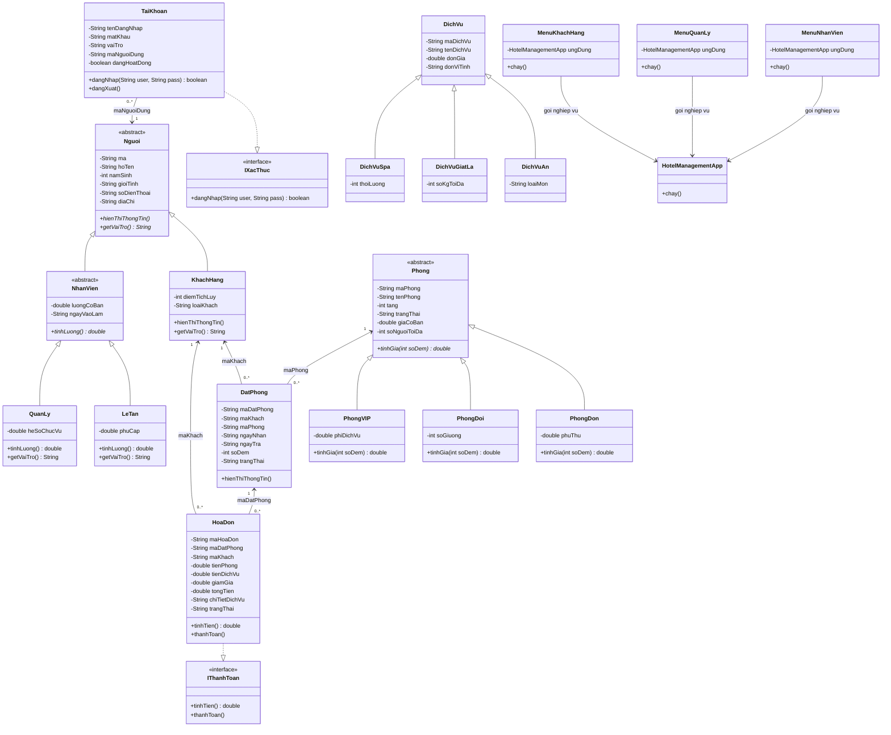

# Class Diagram - HotelManagement

Các quan hệ giữa `DatPhong`, `HoaDon`, `KhachHang` và `Phong` là liên kết logic
qua mã đối tượng (`maKhach`, `maPhong`, `maDatPhong`), không phải thuộc tính
tham chiếu trực tiếp trong Java.
